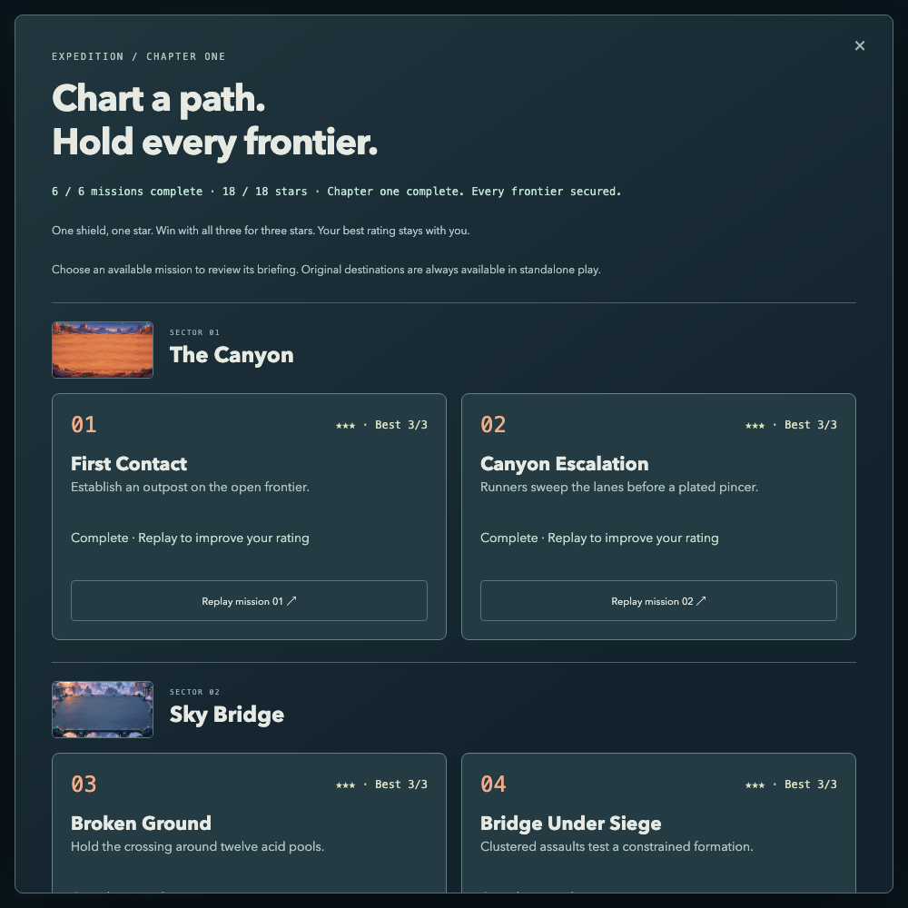
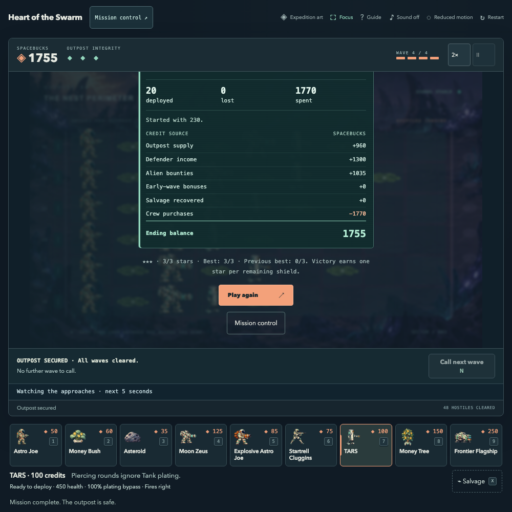

# Expedition 0.6 — Campaign Foundations & Player Progression

## 1. Delivered scope

A complete six-mission, three-environment campaign now shares the original deterministic engine with standalone play. It includes briefings, sequential unlocks, three-star ratings, replay/next actions, chapter completion, versioned local progress and recoverable save failures. Existing illustrated art, nine defenders, six alien types, directional fire, armor, economy, salvage, early calls, warnings and the itemized mission terminal are preserved. No backend, account, permanent upgrade, new roster or hosting change was introduced.

This is an engineering-complete campaign foundation. Difficulty and replay enjoyment are provisional pending independent player observation.

## 2. Baseline review and readiness decision

The clean starting commit was `5647f09b44520af8a0d7382b3532ac2c8362c914` on `modernization`. The full 0.5 report, remaining issues, 102 rule tests, 33 scenarios per engine/99 CI executions, five-player kit, game modules and existing lifecycle/asset tests were reviewed. The connected repository returned no open issues at review time. The initial local browser assessment verified the directional opening instructions, actual Astro placement and paused state. Retained automated checks exercise income/armor explanations, passed-gun advice, early calls, original maps, controls, receipts and loading failures.

No confirmed critical combat or existing save-loss defect blocked campaign work. There was no prior campaign save to migrate. The original rules were retained, rather than changing difficulty without player evidence. The existing five blank player records remain pending. No physical phone, real touch or screen-reader session was supplied. Native Safari became available during 0.6 and received the focused desktop check described below; this does not close all platform gaps.

Readiness decision: proceed with the data model, local progression and a small authored chapter, preserve combat numerics, fix confirmed integration defects, and keep external release-readiness evidence separate.

## 3. Architecture and original migration

[Campaign architecture](CAMPAIGN_ARCHITECTURE.md) documents the module boundaries, schema, lifecycle and extension rules. `environments.ts` owns reusable terrain/background identity and geometry; `missions.ts` owns stable IDs, order, prerequisite, seed policy, briefing and waves. `content.ts` retains units/spawning and a computed original `MAPS` compatibility view. There are no duplicated terrain definitions or parallel combat engines.

The original Canyon becomes `first-contact` (01), Bridge `broken-ground` (03), Nest `into-the-nest` (05). Their arrays are defined once and reused by standalone. `new Simulation(seed, map)`, `chooseMap`, original names and `makeSpawns` remain supported. All original unit definitions, four-wave schedules, offsets, compositions, twelve Bridge and sixteen Nest acid cells match 0.5. The Nest retains its paired late relays.

The default seed remains 3352019; mission replays keep the fixed seeded lane shuffle, while research can explicitly supply another seed. Validation rejects bad references, IDs/order/prerequisites, unsupported enemies, malformed/overlapping schedules and invalid terrain or spawn coordinates before gameplay. The [frozen parity study](../reports/expedition-0.6/research/original-parity.json) verifies every original content export, 36 seeded schedules and 36 complete stepwise simulation/event traces including early calls, pause, speed and restart.

## 4. The six-mission chapter

| #   | Mission / stable ID                       | Environment | Schedule starts / enemies | Tactical purpose                                           |
| --- | ----------------------------------------- | ----------- | ------------------------- | ---------------------------------------------------------- |
| 01  | First Contact / `first-contact`           | Canyon      | 7, 29, 56, 87 / 33        | Original six-lane opening, economy and plating preparation |
| 02  | Canyon Escalation / `canyon-escalation`   | Canyon      | 8, 30, 60, 94 / 42        | Runner sweeps, mixed coverage, paired plated pincer        |
| 03  | Broken Ground / `broken-ground`           | Bridge      | 10, 42, 82, 126 / 36      | Original crossing around twelve fixed acid pools           |
| 04  | Bridge Under Siege / `bridge-under-siege` | Bridge      | 10, 40, 80, 125 / 42      | Close mixed pairs, splash opportunities and plated escorts |
| 05  | Into the Nest / `into-the-nest`           | Nest        | 12, 46, 90, 136 / 38      | Original restricted formation and late paired relays       |
| 06  | Heart of the Swarm / `heart-of-the-swarm` | Nest        | 12, 44, 88, 134 / 48      | Three-stage final relay: anchors, escorts, reinforcements  |

The three new missions use existing roles, compositions and timing. They do not multiply enemy health, move acid, add a boss or require unlocked units. Wave briefings and five-second lane warnings read the same actual schedule consumed by the simulation, including early-call shifts.

## 5. Campaign interface and captures

Mission control groups cards by illustrated environment. Each card shows number, title, description, visible lock/completion reason and best stars. Native disabled review buttons retain accessible descriptions; locked content is discoverable as semantic articles/text. Briefings show tactics, starting resources and the abandonment warning before preparation. Heading/card focus moves explicitly, native dialogs constrain interaction, and backing out keeps the deployment.

[Visual evidence and capture conditions](../reports/expedition-0.6/visual/README.md) distinguish real winning gameplay, empty-progress UI, responsive checks and native Safari smoke captures. The chapter-complete screenshot comes from six actual public-control wins, not a forged save. Phone test fixtures used for navigation/recovery are separately identified and never counted as earned completions.

## 6. Progression and navigation

Mission 01 starts available. Victory unlocks the next mission; completed missions remain replayable and later valid recovered wins are retained. Completion and unlocks derive from best results, avoiding conflicting saved flags. The board displays completed missions out of six, best stars out of eighteen and the next available objective. Six wins produce the chapter-complete message.

Entering Mission control pauses the current game. Closing it keeps the deployment and only resumes a previously playing mission while still visible. Preparing a replacement explicitly says it abandons the current mission. Results offer Play again, Mission control and eligible next-mission briefing; defeat offers replay/return. Returning and inspecting the board never grants a win. Backgrounding requires explicit resume after ordinary dialogs and resource transitions.

## 7. Authoritative ratings and results

A victory earns one star per remaining shield (1, 2 or 3); defeat earns zero. Unused credits do not affect ratings. Current result shows stars, best stars, previous best where applicable, shields, elapsed time and kills. The full signed economy terminal remains intact.

The completion recorder queries the real simulation and checks victory, no pending arrivals/living enemies, valid shields and mission availability. A bounded attempt identity makes duplicate observations harmless; main UI saves once per attempt. Higher stars replace a best result; ties and lower ratings keep the first best result/metadata. A lost replay or abandoned game never erases earned stars. Resetting progress does not immediately re-award the already-observed victory.

## 8. Local saves, recovery and reset

Version 1 stores only stable mission IDs and best stars/shields/duration/kills in `ava-campaign`. Unlocks are derived. No current deployment, simulation serializer, event history, account or cloud service exists. Full schema and error semantics are in the architecture document.

JSON/schema/IDs/star ranges and metadata are validated. Valid wins from partly damaged version-1 data survive; unusable metadata becomes null. The complete original is preserved in `ava-campaign-recovery` before replacement. An existing different backup is not overwritten. Unknown versions remain untouched, with in-memory play and an explicit reset path; there is no invented older campaign format. Storage/backup/write failures never stop the game and show a concise persistent warning rather than repeated modal interruptions.

Before writes, another tab's valid better results merge; newly incompatible/damaged data is protected. Synchronous localStorage is not a transactional multiwriter database, so simultaneous writes can still race. Saves can be edited by the browser owner and are not suitable as trusted leaderboard evidence.

Reset uses a separate native confirmation with Keep progress initially focused. It clears only the two campaign keys. Sound, reduced motion and unrelated data survive. Failed deletion reports that stored progress may return. Browser clearing, another device or a closed unsaved tab cannot be recovered through an account.

## 9. Standalone compatibility

Standalone Canyon remains the initial landing state. Change destination freely exposes the original three missions, regardless of campaign unlocks. The campaign board also links back to standalone. These games never award campaign stars; both modes share all controls, assets, audio and simulation rules. Original/Expedition comparison still changes presentation without resetting live combat. Java source/assets/documentation, original credits and comparison history remain preserved.

## 10. Balance and difficulty evidence

The [reproducible study](../reports/expedition-0.6/research/README.md) contains 540 runs: three new missions × twelve fixed seeds × five policies × automatic/clear-field/aggressive calling. It records actual authoritative outcomes, shields, duration, complete ledgers, losses, purchases, idle exposure and lane coverage. All ledgers reconcile. Results: 491 wins, 49 losses, zero timeouts. No global numerical rebalancing was justified or applied.

Economy, armor, mixed and reactive policies win every sampled combination with three shields. A maintained two-Astro formation wins Canyon/Bridge automatic schedules but becomes vulnerable to aggressive overlap; it wins only 2/12 automatic finale runs and none with early calling. This supports viable alternatives and one concrete risk/reward distinction. It does not prove ideal difficulty, intuitive tactics or fun. Capped strategies leave high balances; that does not justify a credit sink or economy nerf.

Actual browser gameplay completes the six-mission chain with earned credits, actual time and public controls, checks every winning ledger, persists all results, reloads and loses a replay without erasing stars. This is agent-controlled engineering evidence, not independent human testing.

## 11. Performance and assets

[Matched measurements, raw samples, source hashes and cache observations](../reports/expedition-0.6/performance/README.md) document the 0.5/0.6 production comparison. The same 600,697 bytes of initial imagery and deferred school sheets remain. Reported initial transfer changes from 1,003,056 to 1,009,861 bytes (+6,805 / 0.68%); constrained median readiness changes from 5,987.7 to 6,038.0 ms (+50.3 / 0.84%). Normal medians are 153.7 and 146.4 ms, a small difference that is not claimed as a speedup. Three repeated full mission-selection cycles per style plateau at 64/64/64 Expedition and 100/100/100 Original active texture handles with one canvas and no page errors. These are bounded cache observations, not matched GPU-memory measurements. Campaign metadata adds code/text; opening the board loads the existing environment thumbnails, not six game scenes. Same-environment missions share textures; other environment resources commit only on successful demand-driven preparation.

No new imagery, font, network service, runtime dependency, renderer or combat optimization was introduced. Performance findings are delivery/cache observations, not claims of faster frames, lower GPU memory or absence of all leaks. The first optional Original comparison retains its existing download cost. Real mobile thermals, memory pressure and weak networks remain external work.

## 12. Browser/mobile/accessibility validation

The campaign uses semantic headings, cards, buttons, described lock reasons, native dialogs, visible focus and status text. Existing keyboard grid/crew controls, reduced motion, pan/enlarge, touch targets and receipts remain covered. New checks exercise start/review/back/return, explicit abandonment, nested reset/cancel, loss/replay/next, failed artwork cancellation/retry, backgrounding and save failures.

A new enlarged portrait test found a real Chromium defect: `100svh` allowed the native campaign dialog to grow beyond the root's content-zoom viewport, putting Reset outside the screen. Campaign/reset dialogs now bound height to their containing viewport percentage. Frame containment checks were added; pointer interaction reaches reset without forced clicks. Existing compact-phone and enlarged roster checks still pass. Repeat checks use Linux DejaVu font metrics in Firefox/WebKit as well as local Chromium. The six-win flow also tests enlarged phone victory/next navigation.

Native Safari 27.0.1 (22625.1.29.11.28) received an actual desktop smoke check on the production build: board/lock descriptions, focused briefing, preparation, Begin, Return-key Astro deployment, P pause, Original/Expedition comparison while paused, and return to Mission control. Captures preserve the native window. It was not a six-mission native Safari certification or a physical iPhone test.

| Platform                                 | Evidence                                                                                                                     | Remaining limit                                                |
| ---------------------------------------- | ---------------------------------------------------------------------------------------------------------------------------- | -------------------------------------------------------------- |
| Chromium / Firefox / WebKit              | Full retained + campaign automated matrix; exact final CI at delivery                                                        | Engine automation is not every real platform                   |
| Emulated phone portrait/landscape        | 390×844 and 844×390, 150% CSS content zoom, scroll, cards, reset, briefing, result/next and original battlefield regressions | No real touch, OS text-size, thermals or phone memory evidence |
| Native desktop Safari 27.0.1             | Actual focused smoke check above                                                                                             | Full native outcome/failure/device matrix outstanding          |
| Screen readers / physical iOS or Android | No supplied hardware/session                                                                                                 | Outstanding; AX inspection is not a screen-reader session      |

## 13. Independent playtesting

Zero genuine independent first-time sessions were available or invented. The existing five-player protocol and five blank pending CSV rows remain the sole package. It now includes an optional prompted campaign task after spontaneous replay-interest observations: discover Campaign, explain locks/stars/local saves, and observe actual next/reload behavior only if reached. No participants were contacted and no private recordings or identities were committed. No claim about human replay desire or balance validation is made.

## 14. Automated verification and CI

151 rule tests pass, retaining all 102 baseline tests and adding 49 content/progression/persistence cases. Strict TypeScript and production build pass. The 33 original browser scenarios remain, with nine added campaign scenarios: 42 per engine / 126 across Chromium, Firefox and WebKit. The full campaign scenario includes six real wins, phone result navigation, reload and a lost replay. No functional assertion or engine was removed to obtain a pass.

The first new checks corrected two test assumptions: grid cells use accessible names rather than nonexistent data attributes, and touch targets need a minimum height rather than a font-specific exact height. Two retained local checks were interrupted by editing a development module during their run; they reset to Ready, then passed on unchanged sources. A repeated portrait timeout was investigated separately, reproduced as a real dialog containment defect and fixed as described above. An added reset-at-outcome check also reproduced stale best-rating text after successful deletion; invalidating the presentation cache refreshes the result without re-awarding completion. It was not hidden by a longer timeout or forced interaction.

CI retains one software-rendered scene worker per job and all three engines. The job budget increases from 15 to 30 minutes because one added scenario genuinely plays six missions rather than substituting a simulation clock. Exact final revision, job outcomes and workflow URL are verified and linked in the delivery message. [Verification notes](../reports/expedition-0.6/verification/README.md) preserve local coverage and known limits.

## 15. Git delivery and preservation

Work stays on the existing `modernization` branch in the independent `tr3ylbry/TowerDefense` repository, with origin as the only remote. Logical commits separate architecture/progression, campaign UI/lifecycle tests, and documentation/research/performance evidence. Validated changes are pushed without rewriting history. Exact hashes and final CI are reported at handoff.

`master` and the peeled `school-project-2019` tag remain `d5ba2c76aa7cf287b4b89b10ff35cc15a24d09fb`; the annotated tag object remains `de94c0c5097af2a8e2f7662a8ff538136dbb4aa7`. Original Java source, assets, docs, project files, presentation and the historical README section remain unchanged. No other contributor repository, Treydmark website, hosting, domain or deployment infrastructure was modified.

## 16. Remaining issues and Expedition 0.7 recommendation

The highest-value 0.7 scope is **player-experience validation and a focused pacing/onboarding revision**, using the existing five-player kit plus a real phone and screen reader. Observe campaign discovery, first placement/direction, armor/income understanding, early-call decisions, difficulty, rating comprehension and desire to replay. Review which authored encounter actually creates meaningful decisions; make targeted balance/briefing fixes and retest. Do not interpret scripted three-star wins as evidence that permanent upgrades or additional content are needed.

Branching upgrades and pre-mission loadouts would add permanent-state and UI complexity without current human evidence. Challenge modes and additional missions are now easier architecturally, but multiplying provisional content is lower value than validating this chapter. Narrative improvements should follow observed briefing/completion confusion; they are not a separate large campaign-writing expansion yet. Choose this bounded validation/pacing milestone, rather than implementing all future feature ideas.

Release-readiness work still includes actual device touch/text scaling, broader native Safari and assistive-technology coverage, independent sessions, retained-school-art rights/provenance, and honest real-device performance/memory assessment. Local-only saves have no cloud backup and best-effort multi-tab concurrency. Campaign balance is provisional. No 0.7 system, upgrade tree, loadout, new mission batch, account or hosting work is implemented here.
