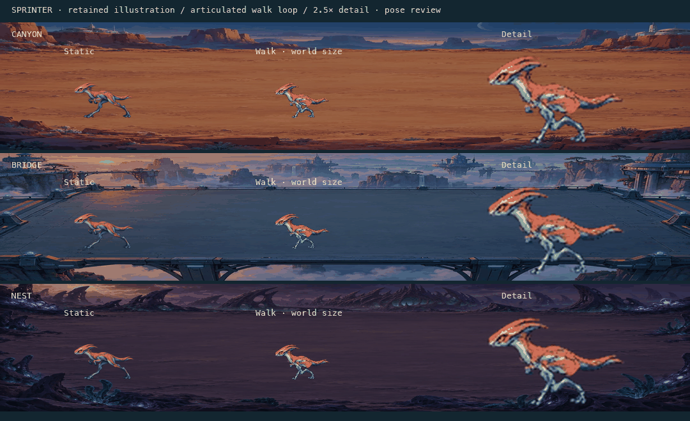

# Expedition 0.9 — True Character Animation & Tactical Challenge

## Delivered behavior

Sprinter now walks with articulated thighs, shins and feet, breathes in its idle presentation, and strikes on its real combat cooldown. One generated parts derivative is baked into a48-pose atlas; no runtime skeletal dependency or second combat engine is introduced. The other aliens retain their existing procedural presentation. Original artwork comparison remains intact. The header uses the requested three-line Astronauts / orbital vs / Aliens wordmark.

First Contact offers one explicitly selected **Hard challenge · prototype** in its campaign briefing. Denser later relays use more existing Sprinters and Tanks. Normal is the default; the original opening, 230 credits, three shields, all unit stats, Normal campaign schedules, saves, stars and standalone behavior remain. Hard results never save stars or unlock missions. It is a playable prototype, not a fully human-balanced campaign difficulty tier.

## Animation architecture and alternatives

Baseline Expedition used one cutout with bob/lean, hit flashes and death fades. Original used school walk/attack/die strips. Full-frame generation was previously rejected in 0.3 for weak useful limb changes and repaint/flicker risk. Runtime layered parts were assessed for continuous interpolation and smaller downloads but would multiply entity display objects and complicate the established lifecycle. They were not implemented or benchmarked.

Selected approach: **layered articulation baked offline, explicit frames at runtime**. Nine extracted parts, controlled pivots, two-bone leg solving and repeated torso pixels produce 24 walk, eight idle and 16 attack poses. The renderer still uses one Sprite per alien. [Architecture](ANIMATION_ARCHITECTURE.md) separates asset production, state selection, simulation timing, rendering, motion preferences and cleanup. [Exact built-in prompt, raw source and conversion](../art-source/expedition-0.9/prompts.md) and [production manifest](../art-source/expedition-0.9/conversion.json) retain provenance and SHA-256.

Walking phase follows interpolated x at 48 world pixels per stride, so 1×/2×, pause and actual movement stay related. Feet alternate planted/swing paths; the torso shifts by half a pixel. Stationary non-attacking presentation idles without adding artificial combat pauses. Attack reads `enemy.attacking` and the 0.75-second cooldown: actual damage resets to contact, then recovery and next-strike anticipation. It never predicts the next hit or changes damage/velocity/collision/economy. Existing hit/death effects remain. Reduced motion selects meaningful static walk/idle/contact poses.

## Visual review and evidence

The GIF reviews a stationary pose loop against all three environments, with actual world size and enlarged detail; it is not a recorded mission. [Unedited real-combat video](../reports/expedition-0.9/visual/real-combat.webm) shows actual spawned walking/attacking Sprinters, adjacent enemies/barriers, pause, 2×, Original switching, reduced motion and restarts through public controls. [Frame review and screenshots](../reports/expedition-0.9/visual/README.md) distinguish fixtures, browser automation and native observations.

The initial small-cap assembly exposed the hip socket and enlarged the arms; it was rejected. The selected muscle pivot overlaps the attachment and uses smaller forearms. The common torso/face retains coral/teal shading, amber eye, crest and spots without pose-by-pose regeneration. Hips are more compact than the source and the tail tip differs slightly; enlarged low-resolution detail is softer. Foot bounds remain within one source pixel of the common ground. Agent review found the pilot recognizable, connected and readable at field scale across all backgrounds. Human appearance preference, dense-motion tolerance and attack readability remain unvalidated. This is one pilot, not a whole-roster art replacement.

## Asset cost and lifecycle

Only one 118,434 B WebP atlas enters production. Initial imagery 600,697→719,131 B; total measured initial transfer 1,010,689→1,130,850 B. Three-sample median readiness 138.4→142.6 ms normally, 6.021→6.652 s under 4× CPU/150 ms/200kB/s constraints. This is an explicit delivery cost, not a claimed speed improvement.

Serial 50-Sprinter render fixtures retained 16.7 ms median frame intervals in both versions; p95 ranges 17.9–18.1 ms before and 16.9–18.2 ms after, no frames over 33.3 ms. One Sprite per alien remains. Median atlas decode≈6.05 ms and synchronous frame initialization≈7.1 ms. Actual phone/VRAM/total-memory performance is not established. [Raw methods, samples, source/build hashes and limitations](../reports/expedition-0.9/performance/README.md) are retained.

Existing on-demand scene/style loading and retry/cancel transactions handle the new atlas. All current missions use Sprinters; no hypothetical future atlases are downloaded. Static illustration/Original fallback assets remain. Repeated selections/styles stabilize at 46/65/101 active texture handles, one above the prior phases, with one canvas and no page errors. Actual-combat comparison preserves paused credits, cells and health. Three restarts and failed-atlas retry are covered. Stable handle counts are retention indicators, not proof of zero leaks.

## Optional challenge investigation

The [candidate study](../reports/expedition-0.9/research/README.md) runs 1,080 scenarios: five configurations × six policies × three call modes × twelve seeds. Normal wins 210/216; timing 194; formations 175;150-credit budget 209; two-defenders-per-lane cap 204. These are fixed synthetic policies, not human difficulty or enjoyment ratings.

Formation B was selected: it increases overlap and visible threat pressure without inflated stats, reduced opening flexibility or a restrictive deployment cap. Mean overlap 12.53→24.64 s, peak live enemies 6.72→9.77, defender losses 2.83→4.59. Economy, armor and mixed policies each win 36/36, reactive 35/36, splash 32/36; ordinary-fire-only cheap loses all 36. Thus TARS is useful but not uniquely required. One bounded splash-policy timeout remains explicitly reported. Candidate data/source and 216 exact shipped-Hard comparisons are retained; no rejected variants are exposed as game tiers.

Hard is selected only in First Contact's mission-control briefing. Its description explains compact lane relays/more Sprinters and Tanks, unchanged health/damage/budget and no saved stars. An in-play Hard label stays separate from 1×/2×. Restarts keep Hard; reviewing/preparing any mission defaults to Normal, and selecting a mission/destination clears it. Warnings and early-wave commands use the same selected authoritative schedule. There is one combat engine and no new persistence schema/rewards.

## Normal preservation and saves

All 1,296 prior 0.8 Normal policy outcomes/research fields match exactly. Read-only max-live/overlap metrics do not affect policy decisions. Thirty-six standalone runs retain frozen 0.5 definitions, seeded schedules, per-tick snapshots/events and outcomes through earned-credit actions, calls, pause, speed and restarts. All six Normal missions, all three standalone destinations, unit/ammunition/terrain definitions and the shield-based rating model remain.

Both UI saving and `CompletionRecorder` reject Hard. Tests retain existing Normal best records byte-for-byte after a stronger Hard win, assert no save after public-control Hard victory/defeat, and then earn a real three-star Normal victory. Version 1 and the existing isolated storage/recovery behavior are unchanged. Difficulty lives outside the established deterministic snapshot shape and is not saved.

## Browser, keyboard and native evidence

New browser scenarios cover pose transitions, pause/speed/reduced motion, all backgrounds, actual Sprinter attacks/comparison/restarts, atlas failure/retry, desktop/phone Hard briefing, opt-in/reset behavior and earned-credit result/save isolation. The pre-existing 50 scenarios per engine remain. Final branch-wide Chromium/Firefox/WebKit results and the exact Actions run are recorded in the delivery response; this report does not treat a queued job as passed.

Native desktop Safari completed an earned-credit **First Contact Hard victory: 33 kills, three shields, 1m 58s, 12 deployments, zero losses, 900 spent, 690 supply, 680 bounties, 700 remaining**. No income, early-call bonus or salvage was used. It preserved 50 credits/three shields/wave 2 during Original→Expedition comparison, used P/arrow focus recovery and 2×, showed actual animated Sprinters, and returned to a0/6,0/18 campaign board. Reviewing/preparing Normal restored its 230-credit ready state. [Native record and screenshots](../reports/expedition-0.9/visual/native-safari.json) identify the exact desktop browser build. Only the agent-created test tab was closed; the pre-existing Safari tab was preserved.

Phone screenshots are emulation. Native Safari victory is agent-driven desktop evidence, not iOS or human playtest evidence. New reduced-motion state behavior is covered by rules/browser checks; live screen-reader speech and native active-combat reduced-motion review were not observed. Existing keyboard, semantic controls, centered time buttons, focus recovery, credit descriptions and economy terminal remain.

## Verification and delivery

- 176 rule tests, strict TypeScript and production build pass locally.
- 56 browser scenarios per engine: 50 preserved + six new. The six new Chromium cases passed across the focused run/corrected result-label rerun; final all-engine validation is associated with the delivered Git head.
- 1,080 candidate runs +216 production-Hard equivalence runs.
- 1,296 unchanged Normal runs and 36 original standalone parity runs.
- Source/production alpha is exact after WebP encoding; generated source, conversion and rejected-assembly rationale are recorded.

Corrections during validation: Playwright requires the optional video setting at file scope, not inside a describe group; it is now an explicit local recording option. A new test initially expected “Mission complete” where the established UI says “Outpost secured”; the assertion was corrected and the complete Hard→loss→Normal save journey passed. No assertion or browser engine was removed to obtain success. A render timing probe overlapped a development check and was retained separately; the final comparison was rerun serially. Incompatible standalone ffmpeg prevented optional transcoding, so the unedited Playwright recording is retained and Pillow exports the pose-loop GIF.

Work targets `modernization`; exact commits/push and CI status belong to the delivery record. Original Java source, school assets/docs, original contributor credits, `master`, `school-project-2019` and history are preserved. No Treydmark site, deployment, DNS, accounts, cloud saves, new roster, maps, missions or full-roster animations are introduced.

## External validation and 1.0 decision

The existing five independent first-time-player sessions remain **0/5 pending**. Developer Canyon observations are separate. No participants, enjoyment scores, phone tests or assistive-technology findings are invented; the existing kit remains the collection route. Physical-phone performance/touch, live screen-reader use and publication rights for retained school assets still need resolution.

Proceed toward a scoped 1.0 preparation milestone, not an immediate roster-wide rollout or release. First collect genuine movement/attack readability and difficulty observations; refine this pilot if needed. Then trial one different body shape under a measured asset budget. Keep Hard limited to First Contact until players support expansion. Complete physical-device/accessibility and retained-art permission work before public website integration. No 1.0 feature rollout or hosting work is implemented in 0.9.
